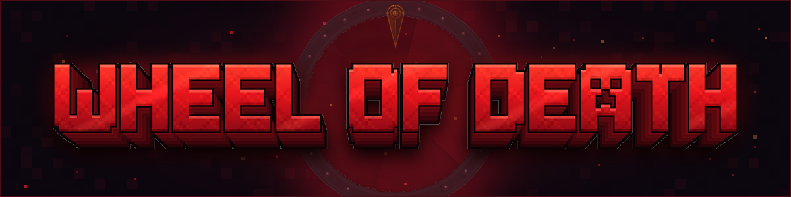

<p align="center">
  
</p>

<p align="center">
  &nbsp;
  &nbsp;
  &nbsp;
  
</p>

<p align="center">
  <em>Cada giro empeora tu mundo. Un mod hardcore de ruleta progresiva con +100 castigos acumulables, vidas limitadas, jefes exclusivos y resurrección cooperativa para Minecraft Fabric.</em>
</p>

---

## Estado del Proyecto

Este proyecto se encuentra **en desarrollo activo (Work in Progress)** rumbo a su publicación en CurseForge. Las mecánicas, balanceo y configuraciones siguen recibiendo mejoras y ajustes constantes.

---

## ¿Qué incluye el mod?

- **Ruleta de +100 Castigos (6 Niveles de Peligro):** cada giro añade un nuevo cambio de dificultad permanente que se combina con los anteriores, desde ajustes de supervivencia en Nivel 1 hasta amenazas extremas en Nivel 6, con animación en HUD y sonido diferenciado por nivel.
- **Sistema de Vidas Limitadas y Resurrección Natural:** configura vidas iniciales por jugador, recupera vidas con el **Corazón Rojo** y revive compañeros caídos mediante el **Corazón Dorado**, un menú interactivo de selección y un ritual visual en superficie.
- **Mobs y Amenazas Exclusivas:** enfrenta variantes y entidades personalizadas como el *Coloso de Ruina*, *Creeper Termonuclear*, *Creeper de Implosión Antimateria*, *Nigromante de las Criptas*, *Hombre Roca*, *Mimics*, *Phantom Alfa*, *Phantoms Raptores* y más.
- **Eventos Globales y Mecánicas Especiales:** *Luna de Sangre*, *Eclipse Total*, sistema de *Cordura* con alucinaciones, animación de muerte personalizada e indicadores en HUD.
- **Panel de Administración In-Game:** gestiona vidas, temporizador automático de giros y maldiciones activas desde una interfaz visual sin editar archivos manualmente.

---

<details>
<summary><strong>Comandos principales</strong></summary>

| Comando | Descripción | Permisos |
| :--- | :--- | :--- |
| `/ruleta girar [1-6]` | Gira la ruleta de forma aleatoria (o forzada a un nivel del 1 al 6). | OP |
| `/ruleta estado` | Abre el menú visual con todas las maldiciones activas y su explicación. | Todos |
| `/ruleta config` | Abre el panel de administración (modo automático/manual y vidas iniciales). | OP |
| `/ruleta vidas <agregar\|quitar> <jugador> <cantidad>` | Agrega o quita vidas directamente a un jugador. | OP |
| `/ruleta revivir <jugador>` | Inicia el ritual de resurrección para un jugador eliminado. | OP |
| `/ruleta activar <id>` | Activa directamente un castigo específico por su identificador. | OP |
| `/ruleta limpiar` | Restablece todos los castigos activos del mundo. | OP |

</details>

<details>
<summary><strong>Requisitos e instalación</strong></summary>

- **Minecraft:** `26.3`
- **Fabric Loader:** `0.19.5` o superior
- **Fabric API:** `0.163.0+26.3` o superior
- **Java:** `25`

Coloca el archivo `.jar` del mod junto con **Fabric API** dentro de tu carpeta `mods/` (compatible tanto en un jugador como en servidor dedicado).

</details>

<details>
<summary><strong>Compilación desde fuentes</strong></summary>

Para compilar el proyecto manualmente:

```bash
./gradlew build
```

El archivo compilado se generará en `build/libs/`.

</details>

---

## Acerca del Proyecto

- **Objetivo:** ofrecer una experiencia hardcore personalizable, tensa y rejugable para partidas multijugador entre amigos.
- **Transparencia:** este mod se desarrolla utilizando herramientas de Inteligencia Artificial como soporte y copiloto en la programación. El código se mantiene abierto para revisión, aprendizaje y colaboración.

## Licencia

Este proyecto es de código abierto y se distribuye bajo la licencia [CC0 1.0 Universal](LICENSE). Consulta el archivo [LICENSE](LICENSE) para más información.
